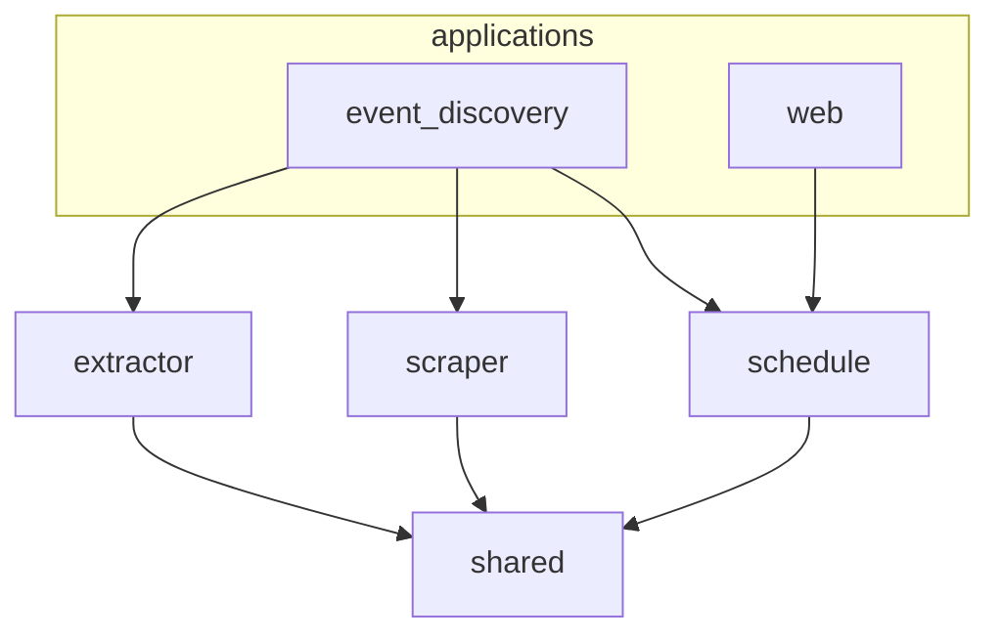

# Architecture

The code lives under `src/lagransala/` and is split into four bounded contexts plus
the applications that wire them together.

| Package | Responsibility |
|---------|----------------|
| `schedule` | Venues and events: the persisted domain models and the venue seeding. |
| `scraper` | Finding and reading venue pages: pagination strategies, content scrapers and a generic crawler. |
| `extractor` | Turning page content into structured events with an LLM. |
| `shared` | Cross-cutting utilities: the HTTP fetcher, caching, URL and markdown helpers. |
| `applications` | Entry points that combine the contexts: `event_discovery` and `web`. |



## Layers

Each context follows the same three-layer structure:

```text
context/
├── domain/          # entities, value objects and Protocol interfaces
├── application/     # use cases and application services
└── infrastructure/  # technical implementations (HTTP, files, LLM clients)
```

Dependencies only point inwards: `infrastructure` depends on `application`, which
depends on `domain`, which depends on nothing but `shared`. Interfaces such as
`Fetcher`, `EventExtractor` or `CacheBackend` are `Protocol` classes defined in the
domain layer and implemented in `infrastructure`, so the pipeline can swap
implementations (for example the Groq extractor for the LiteLLM one) without
touching the rest.

## Import rules

- Use relative imports inside a bounded context and absolute imports across
  contexts.
- Import from the layer package (`lagransala.schedule.domain`), which defines
  `__all__`, instead of from individual modules.
- Contexts never import each other. They only share code through `shared`.
- Applications may depend on any context.

These rules are enforced by [Import Linter](https://import-linter.readthedocs.io/)
with four contracts declared in `pyproject.toml`:

| Contract | Type | Rule |
|----------|------|------|
| `schedule layers` | layers | `infrastructure` → `application` → `domain` → `shared` |
| `scraper layers` | layers | `infrastructure` → `application` → `domain` → `shared` |
| `extractor layers` | layers | `infrastructure` → `application` → `domain` → `shared` |
| `bounded contexts` | independence | `schedule`, `scraper` and `extractor` must not import each other |

Run them with:

```bash
uv run lint-imports
```
