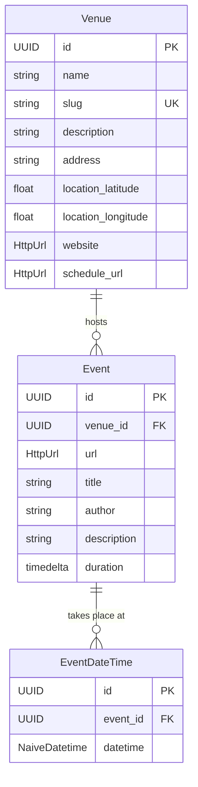

# Domain models

## Persisted models

The `schedule` context defines the three tables stored in SQLite, as SQLModel
classes.

- **`Venue`** is identified by a unique `slug` (lowercase letters, digits and
  hyphens). The slug links a venue to its pagination and content scraper
  configuration.
- **`Event`** belongs to one venue. `url` is the page the event was extracted from.
- **`EventDateTime`** holds one date and time. An event can have several, for
  example a film screened on different days.

!!! note "Naive datetimes"
    `EventDateTime.datetime` is a naive datetime: it is the wall-clock time at the
    venue, not an instant in UTC. It is annotated as `NaiveDatetime` because
    SQLModel rejects naive datetimes otherwise.

!!! note "URL columns"
    `HttpUrl` fields are stored as strings through a custom column type built by
    `build_sqlmodel_type`, which validates the value when binding and converts it
    back to `HttpUrl` when reading.

## Extraction models

The `extractor` context defines plain Pydantic models for the output of the LLM.

| Model | Purpose |
|-------|---------|
| `EventData` | One extracted event: `title`, `description`, `schedule` (a list of datetimes), `duration`, `author`, `tags`, `category` (`cine`, `coloquio` or `live_music`) and `price` (euros, up to two decimals). |
| `EventExtraction` | The list of `events` found in one page, with an `empty_reason` when the list is empty. |
| `SourcedEventExtraction` | An `EventExtraction` plus the `model` used, the `source_url` and the extraction datetime `dt`. |
| `EmptyReason` | `only_past`, `no_events_found`, `empty_content` or `extraction_error`. |
| `SourcedContent` | A page's `content` with its `url`, `fmt` (`ContentFormat`: `markdown`, `html` or `empty`) and fetch datetime. Content that is blank is normalised to the `empty` format. |

`EventExtractor` is the `Protocol` every extractor implements:
`extract(content, context=None) -> SourcedEventExtraction`.

!!! warning "Fields that are extracted but not stored"
    `EventData` carries `tags`, `category` and `price`, but the `Event` table has no
    columns for them, so they are dropped when the pipeline stores the events.

## Scraping models

The `scraper` context describes how to read each venue. Both are loaded from JSON
files in `seeds/` (see [Event discovery](pipeline.md#venue-configuration)).

- **`Pagination`** describes the listing pages of a venue and how to find the links
  to individual events: `url`, `base_url`, `element_url_pattern` and a
  `PaginationType`:

    | Type | Behaviour |
    |------|-----------|
    | `none` | A single listing page. |
    | `simple` | `url` contains `{n}`; pages `simple_start_from` to `simple_start_from + limit - 1`. |
    | `day` | `url` contains `{date}`; one page per day for `limit` days starting today, formatted with `date_format`. |
    | `month` | `url` contains `{month}`; one page per month for `limit` months starting this month, formatted with `date_format`. |

    The model validates that the fields required by each type are present.

- **`ContentScraper`** has the venue's `venue_slug` and an optional CSS
  `main_selector` used to pick the part of the page that holds the programme.

## Fetching

`Response` (in `shared`) is the result of fetching a URL: `url`, `status`,
`content`, `content_type` and `dt`. `Fetcher` is the `Protocol` implemented by
`AiohttpFetcher`.
