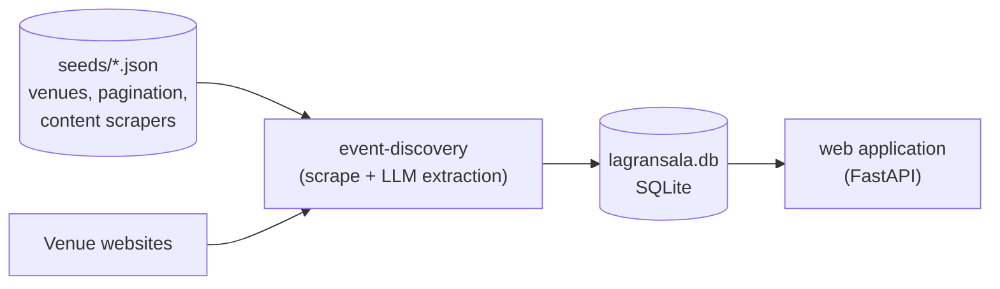

# La Gran Sala

La Gran Sala discovers and catalogs cultural events (cinema, talks, live music)
from a set of venues in Madrid. It scrapes each venue's programme, uses an LLM to
turn the pages into structured events, stores them in a SQLite database and serves
them in a small web application.



## Where to start

- [Architecture](architecture.md): bounded contexts, layers and the import rules
  that keep them apart.
- [Domain models](domain-models.md): venues, events and the models used while
  extracting them.
- [Event discovery](pipeline.md): how the pipeline turns a venue website into
  stored events, and how to configure a new venue.
- [Web application](web.md): the read-only schedule view.
- [Development](development.md): environment, tooling, tests and releases.
- [Reference](reference/index.md): API reference generated from the code.

## Venues

The seed data currently covers eight venues: Círculo de Bellas Artes, Noches del
Botánico, Café Berlín, Tempo audiophile club, Casa de América, Cine Doré, Cineteca
Madrid and Museo Reina Sofía.

## Quick start

```bash
uv sync --dev
cp .env.template .env             # add your API keys
uv run lagransala event-discovery # scrape venues and fill lagransala.db
uv run lagransala web             # serve http://localhost:8000
```

See [Development](development.md) for the Nix and direnv based environment.
