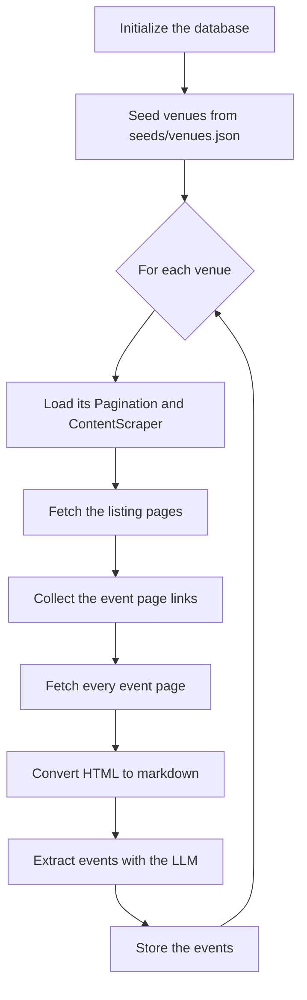

# Event discovery

The `event_discovery` application turns the websites of the configured venues into
rows in the database.

```bash
uv run lagransala event-discovery          # INFO logs
uv run lagransala --debug event-discovery  # DEBUG logs (--ddebug for TRACE)
```

## Flow



1. **Database.** `lagransala.db` is opened (and its tables created if they do not
   exist). If the `venue` table is empty it is filled from `seeds/venues.json`;
   otherwise seeding is skipped.
2. **Venue configuration.** For every venue, sorted by name, the pipeline loads its
   `Pagination` and `ContentScraper` from the seed files. A venue without an entry
   in either file raises a `ValueError` and stops the run.
3. **Listing pages.** `pagination.urls()` produces the listing URLs. They are
   fetched, and the links that match `element_url_pattern` are collected and made
   absolute with `base_url`.
4. **Event pages.** Every collected page is fetched concurrently through
   `AiohttpFetcher` (at most 12 requests at a time by default).
5. **Markdown.** Each HTML page becomes markdown: `script`, `style`, `nav`,
   `header` and `footer` elements are removed, the `main_selector` (or `body`) is
   converted with `markdownify` and blank lines are collapsed. Pages are then
   ordered by the earliest ISO date (`YYYY-MM-DD`) found in their text, and pages
   with no date go last.
6. **Extraction.** Each page is sent to the extractor as its own asynchronous task.
   Empty pages produce an empty extraction with the reason `empty_content`. A task
   that fails is logged and skipped, it does not stop the venue.
7. **Storage.** Every `EventData` becomes an `Event` with one `EventDateTime` per
   entry in `schedule`.

!!! warning "Every run replaces all events"
    Before processing the venues, the pipeline deletes all existing events and their
    datetimes. The database only ever holds the result of the last run, so a run
    that fails halfway leaves it incomplete.

## Venue configuration

Three JSON files in `seeds/` describe the venues. They are linked by the venue
`slug`.

=== "venues.json"

    ```json
    {
      "name": "Círculo de Bellas Artes",
      "slug": "circulo-bellas-artes",
      "description": "",
      "address": "Calle de Alcalá, 42, 28014 Madrid",
      "website": "https://circulobellasartes.com/",
      "location_latitude": 0,
      "location_longitude": 0
    }
    ```

=== "paginations.json"

    ```json
    {
      "venue_slug": "cineteca-madrid",
      "type": "simple",
      "url": "https://www.cinetecamadrid.com/programacion?page={n}",
      "limit": 3,
      "simple_start_from": 0,
      "base_url": "https://www.cinetecamadrid.com",
      "element_url_pattern": "^/programacion/[\\w-]+"
    }
    ```

=== "content_scrapers.json"

    ```json
    {
      "venue_slug": "circulo-bellas-artes",
      "main_selector": null
    }
    ```

See [Scraping models](domain-models.md#scraping-models) for the pagination types.
To add a venue, add an entry to each file. Since venues are only seeded into an
empty table, an existing database needs the new venue inserted by hand or removed
so it is seeded again.

## Extractors

The pipeline uses `GroqEventExtractor` with the `openai/gpt-oss-120b` model and a
rate limit of 30 requests per minute. It needs a Groq API key in the environment
(`GROQ_API_KEY`).

The `extractor` context also contains `GeminiEventExtractor`,
`InstructorEventExtractor` and `LitellmEventExtractor`, all implementing the
`EventExtractor` protocol. They are not wired into the pipeline: the Instructor
one has an initializer (`initialize_instructor_extractor`) that is commented out in
`main`. Switching extractor means changing that line.

## Caching

Responses are cached on disk under `.cache/` to avoid repeated requests and LLM
costs while developing.

| Directory | Content | TTL |
|-----------|---------|-----|
| `.cache/fetch` | HTTP responses | 10 minutes for listing pages, 23 hours for event pages |
| `.cache/extract` | `SourcedEventExtraction` results | none |
| `.cache/groq_chat_completion` | raw Groq chat completions | none |

Delete the directory to force a fresh run.

## Observability

Functions are traced with [Langfuse](https://langfuse.com/) through `@observe`, and
each venue's trace is tagged with its slug. Without the `LANGFUSE_*` variables the
client disables itself and logs an authentication warning at startup.

## Related code

`Crawler` (in `scraper.application`) is a generic same-host crawler that returns the
pages it finds. The pipeline does not use it: it relies on pagination instead.
